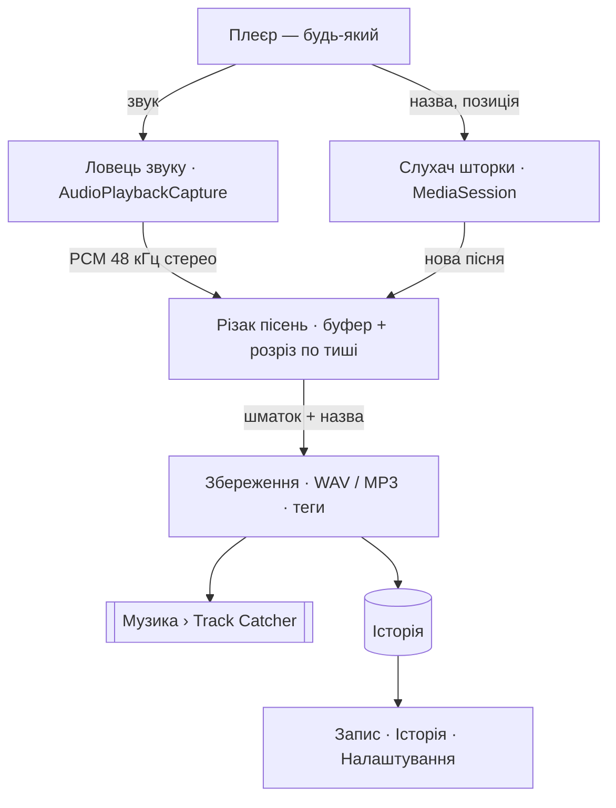

# Track Catcher — задум і план

Візуальний план з діаграмами (як ловиться пісня, компоненти, стани, послідовність, дані): артефакт «Track Catcher» — https://claude.ai/artifact/Mpd3sDnDc6NpnLK2kqXJpN

## Задум (faric, 13.10.2026)

> «…записував не тільки WAV, а ще й MP3. Старт/стоп — це зрозуміло, але щоб він міг розрізнити, що одна пісня закінчилася, починається нова… записує в буфер, отримує ім'я файла, при закінченні запису цей файл зберігає і дає йому ім'я таке, яке було в рядку стану зверху шторки. І щоб так 10–20 пісень грало, а він їх усі підряд писав і окремо зберігав файли в тому форматі, в якому я скажу. І щоб із додатку можна було дивитися історію: які файли були створені, вдало, невдало чи ще щось.»

## Як працює

1. Звук пишеться без перерв у тимчасовий файл на диску.
2. Шторка каже «нова пісня» → чекаємо 2 с, шукаємо тишу в ±2 с і ріжемо там; немає тиші — по сигналу; швидке перемикання — одразу.
3. Шматок → черга збереження (запис не зупиняється) → обрізати тишу на краях → повний / неповний / невдало / пропущено → файл(и) з тегами → історія.

## Етапи

Перша версія (v0.1.0) містить усе з плану v2 одразу — на прохання власника «від початку до кінця». Перевірка на телефоні — крок за кроком (`STATUS.md`).

## Межі

- Деякі застосунки забороняють запис свого звуку — буде тиша → «невдало» з причиною.
- Дзвінки, системні звуки й звук самого Track Catcher не пишуться.
- Плеєр без повідомлення в шторці → одна довга «Невідома пісня» без розрізу.
